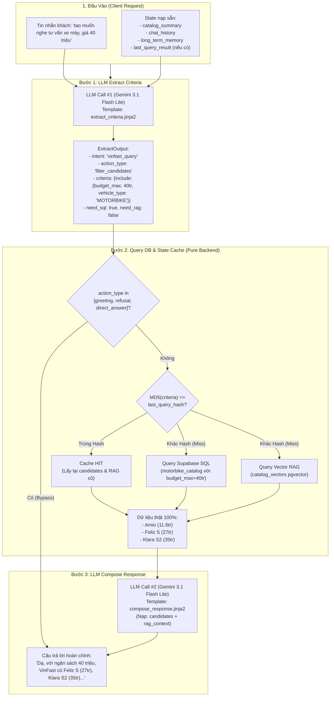

# 🗺️ BẢN ĐỒ KIẾN TRÚC & LUỒNG DỮ LIỆU – VINFAST AI ADVISOR
## Hệ thống Multi-pass Tool-Calling & State-Based Cache (v3.1)

---

## 📁 1. SƠ ĐỒ CẤU TRÚC FILE LIÊN QUAN

```
d:\PROJECT_AI20K\P-101\
├── src\
│   ├── agents\
│   │   ├── graph.py                   # Graph chính LangGraph (StateGraph)
│   │   ├── state.py                   # Schema AgentState (quản lý state phiên chat)
│   │   ├── prompts\
│   │   │   ├── extract_criteria.jinja2  # [B1] Prompt bóc tách criteria + cờ SQL/RAG
│   │   │   └── compose_response.jinja2  # [B3] Prompt soạn câu trả lời từ dữ liệu thật
│   │   └── nodes\
│   │       ├── preprocess.py          # Fast router + in-memory catalog cache (0.16s)
│   │       ├── catalog_router.py      # Bộ định tuyến danh mục xe
│   │       ├── guardrails.py          # Kiểm duyệt an toàn / out-of-scope
│   │       └── needs_discovery.py     # [CORE] Node 3 bước: Extract -> Query DB -> Compose
│   ├── services\
│   │   ├── catalog_service.py         # Query Supabase: car_catalog & motorbike_catalog
│   │   ├── database.py                # SessionLocal (PostgreSQL / SQLite fallback)
│   │   ├── chat_history_service.py    # Quản lý lịch sử, tóm tắt rolling summary & tạo quote
│   │   ├── llm.py                     # Quản lý connection pool Gemini/OpenAI (@lru_cache)
│   │   └── rag_service.py             # Vector Search trên pgvector (catalog_vectors)
│   └── api\
│       ├── routes.py                  # FastAPI SSE streaming & prepare_session_state
│       └── ...
```

---

## 🔄 2. BẢN ĐỒ LUỒNG THỰC THI (MULTI-PASS EXECUTION FLOW)



---

## 📊 3. BẢNG ÁNH XẠ HÀNH ĐỘNG (ACTION_TYPE MAPPING MATRIX)

| action_type | Mục đích | B2 Query DB? | B3 Compose | Phản hồi mẫu |
| :--- | :--- | :---: | :---: | :--- |
| `greeting` | Chào hỏi mở đầu | ❌ **Bypass** | Direct | *"Dạ em chào anh/chị! Em có thể giúp gì cho anh/chị về xe VinFast ạ?"* |
| `collect_criteria` | Thu thập nhu cầu khi criteria chưa đủ | ⚠️ **Cache/Skip** | LLM Compose | *"Dạ anh/chị dự kiến số chỗ ngồi hoặc tầm tài chính khoảng bao nhiêu ạ?"* |
| `filter_candidates` | Lọc danh sách xe theo tiêu chí (giá, chỗ, loại xe) | ✅ **SQL Filter** | LLM Compose | Liệt kê các xe thật khớp trong Supabase kèm giá niêm yết chính thức. |
| `compare_vehicles` | So sánh 2+ xe cụ thể (hoặc dùng đại từ *"2 xe này"*) | ✅ **SQL + RAG** | LLM Compose | So sánh chi tiết thông số pin, quãng đường, trang bị dựa trên RAG context. |
| `recommend_vehicle`| Đã chốt 1 xe cụ thể | ✅ **Detail Query** | LLM Compose | Giới thiệu chi tiết mẫu xe và chuẩn bị bước tính chi phí TCO. |
| `request_quote` | Khách yêu cầu báo giá chính thức | ✅ **Trigger Quote** | Action Return | Tự động tạo bản ghi báo giá chờ duyệt trong CSDL Supabase. |
| `direct_answer` | Câu hỏi đặc biệt/oái oăm (xe xăng, xe lai...) | ❌ **Bypass** | Direct | Giải thích chính sách 100% xe thuần điện một cách khéo léo, tự nhiên. |
| `refusal` | Nội dung ngoài phạm vi / nhạy cảm / toxic | ❌ **Bypass** | Refusal | Từ chối lịch sự và hướng khách hàng về chủ đề xe điện VinFast. |

---

## 🎯 4. CẤU TRÚC DỮ LIỆU STATE (AGENT STATE SCHEMA)

| Trường (Field) | Kiểu dữ liệu | Ý nghĩa |
| :--- | :--- | :--- |
| `messages` | `list[dict]` | Danh sách tin nhắn dạng lịch sử hội thoại |
| `catalog_summary` | `str` | Bản tóm tắt danh mục các dòng xe VinFast đang kinh doanh |
| `chat_history` | `list[dict]` | 10 lượt hội thoại gần nhất dùng cho prompt |
| `long_term_memory` | `dict` | Sở thích, thói quen sạc, ngân sách tích lũy của khách |
| `last_query_hash` | `str (MD5)` | Hash của tiêu chí lượt trước (dùng để kiểm tra Cache Hit) |
| `last_query_result` | `dict` | Bộ nhớ tạm lưu kết quả `{candidates, rag_context}` |
| `candidate_cars` | `list[dict]` | Danh sách các xe thật trả về từ CSDL Supabase |
| `user_profile` | `dict` | Hồ sơ nhu cầu hiện hành (`budget_max`, `seat_count`, `target_model`...) |
| `response` | `str` | Câu trả lời cuối cùng gửi về cho người dùng qua SSE Stream |

---

## 💡 5. TẠI SAO KIẾN TRÚC NÀY TỐI ƯU VÀ CHÍNH XÁC 100%?

1. **Triệt tiêu Ảo giác (0% Hallucination):** LLM ở bước Compose chỉ được phép nhìn thấy dữ liệu thật đã được query từ CSDL Supabase ở Bước 2.
2. **Không dùng Regex / Hardcode:** Tận dụng khả năng đọc hiểu ngôn ngữ tự nhiên của LLM ở Bước 1 để phân tích đại từ chỉ định (*"2 xe này"*, *"chiếc trước"*) và câu đính chính (*"nhầm, ý tôi là"*).
3. **Tiết kiệm tài nguyên & Độ trễ thấp (Low Latency):**
   * Preprocess router in-memory chỉ tốn **0.16s**.
   * State Cache bỏ qua các truy vấn DB thừa khi khách chat các câu nối tiếp (*"Alo"*, *"Sao lâu thế"*).
   * Bypass truy vấn DB hoàn toàn với các câu chào hỏi/từ chối.
