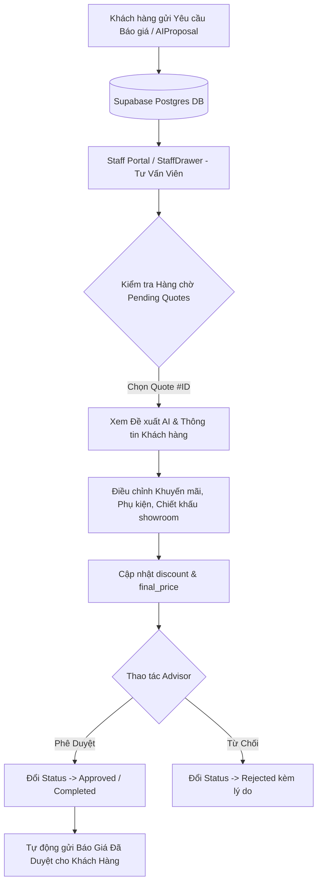
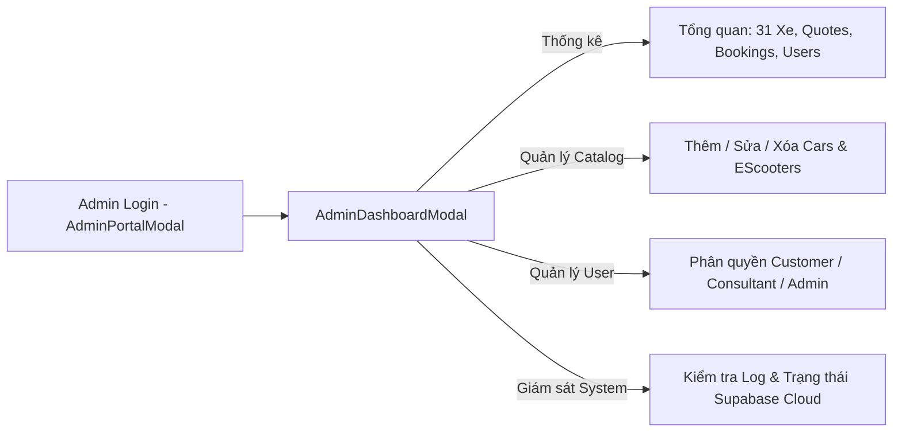
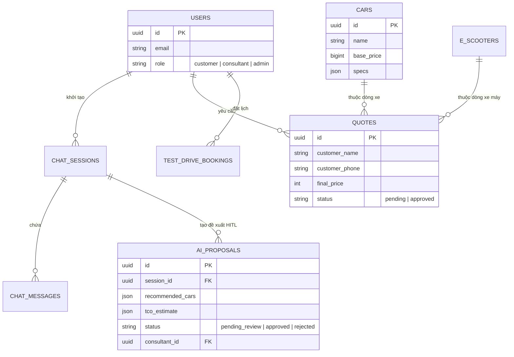

# 🎨 WIREFRAME & UI/UX WORKFLOW SPECIFICATION
## Hệ Thống VinFast O2O Sales & AI Advisor Agent (Team T-101)

> **Repository GitHub**: `https://github.com/AI20K-Build-Phase-Cohort-3/P-101`  
> **Kiến trúc Thực tế**: React 18 + Vite + TypeScript (Frontend) \| FastAPI 0.115 + Async SQLAlchemy 2.0 + Supabase PostgreSQL (Backend)  
> **Mốc đánh giá**: Gate 1 — Sơ Đồ Luồng & Bản Vẽ Giao Diện Chi Tiết  

---

## 🗺️ 1. SƠ ĐỒ WORKFLOW HỆ THỐNG THỰC TẾ (SYSTEM WORKFLOWS)

### 1.1 Complete Customer O2O Journey Flow (Luồng Khách Hàng)

```mermaid
flowchart TD
    Start([Khách hàng truy cập Web Vin_ai]) --> Home[Trang chủ Landing Page - Hero & Showcase]
    
    Home --> Choice{Hành động Khách hàng}
    
    %% Nhánh 1: Chat với AI Advisor
    Choice -->|Bấm Chat với AI| AIChat[AIChatWidget - VinFast AI Advisor]
    AIChat --> CollectInfo[Thu thập nhu cầu: Ngân sách, Số người, Quãng đường/ngày]
    CollectInfo --> Recommend[AI khớp dữ liệu DB Cars/EScooters & Đề xuất Top 1-3 Xe]
    Recommend --> QuoteReq[Yêu cầu Báo Giá / Đặt Lịch Lái Thử]
    
    %% Nhánh 2: Xem Catalog & So Sánh Xe
    Choice -->|Duyệt Catalog| Showcase[VehicleShowcase - Danh mục 31 xe]
    Showcase --> DetailModal[VehicleDetailModal - Thông số kỹ thuật chi tiết]
    Showcase --> CompareBar[CompareBar - Chọn 2-3 mẫu xe]
    CompareBar --> CompareModal[CompareModal - So sánh song song Matrix]
    CompareModal --> QuoteReq
    DetailModal --> QuoteReq
    
    %% Đỉnh điểm O2O: Đơn Báo Giá & Đặt Lịch Lái Thử
    QuoteReq --> CreateQuote[Tạo bản ghi Quote / TestDriveBooking (Status: Pending)]
    CreateQuote --> PendingHITL[Chờ Sales Advisor duyệt tại StaffDrawer]
    PendingHITL --> ReceivedQuote[Khách hàng nhận Báo giá chính thức & Lịch lái thử đã xác nhận]
```

---

### 1.2 Sales Advisor HITL Approval Workflow (Luồng Tư Vấn Viên Duyệt Báo Giá)



---

### 1.3 Admin Management Workflow (Luồng Quản Trị Hệ Thống)



---

## 📐 2. BẢN VẼ PHÁC THẢO GIAO DIỆN CHUẨN KỸ THUẬT (WIREFRAMES)

### 2.1 Wireframe 1: Trang Chủ & Widget Chat AI Advisor (`App.tsx` + `AIChatWidget.tsx`)

```
+-----------------------------------------------------------------------------------+
| [LOGO VINFAST]  Trang chủ  Ô tô điện  Xe máy điện  Bảng giá  Lái thử  [Login/Profile]|
+-----------------------------------------------------------------------------------+
| HERO SECTION                                                                      |
|  "TIÊN PHONG TƯƠNG LAI DI CHUYỂN XANH"                                            |
|  [ Nút: Khám phá dải xe ]   [ Nút: Chat với AI Advisor ]                            |
+-----------------------------------------------------------------------------------+
| VEHICLE SHOWCASE (DANH MỤC 31 XE VINFAST)                                         |
| [Tất cả] [SUV] [Xe máy điện] [Giá rẻ nhất]                                        |
| +-----------------------+ +-----------------------+ +-----------------------+    |
| | [Hình VF 3]           | | [Hình VF 6]           | | [Hình Klara S]       |    |
| | VinFast VF 3          | | VinFast VF 6          | | Klara S               |    |
| | Giá: 235.000.000đ     | | Giá: 675.000.000đ     | | Giá: 30.000.000đ      |    |
| | [So sánh] [Chi tiết]  | | [So sánh] [Chi tiết]  | | [So sánh] [Chi tiết]  |    |
| +-----------------------+ +-----------------------+ +-----------------------+    |
+-----------------------------------------------------------------------------------+
                                                      | AI CHAT WIDGET (OPEN)       |
                                                      | +-------------------------+ |
                                                      | | VinFast AI Advisor      | |
                                                      | | (AI) Bạn cần tư vấn xe  | |
                                                      | |  ngân sách bao nhiêu ạ? | |
                                                      | | [Dưới 500tr] [500-1 tỷ] | |
                                                      | | (User) Mình tìm xe 7 chỗ| |
                                                      | | (AI) Gợi ý VF9 7 chỗ... | |
                                                      | | [Nhập tin nhắn...] [Gửi]| |
                                                      | +-------------------------+ |
+-----------------------------------------------------------------------------------+
```

---

### 2.2 Wireframe 2: Ma Trận So Sánh Xe Song Song (`CompareModal.tsx`)

```
+-----------------------------------------------------------------------------------+
| SO SÁNH CHI TIẾT DÒNG XE VINFAST                                          [ ĐÓNG ]|
+-----------------------------------------------------------------------------------+
| TIÊU CHÍ SO SÁNH     | VINFAST VF 6 PLUS          | VINFAST VF 8 PLUS             |
+----------------------+----------------------------+-------------------------------+
| Hình ảnh             | [ Hình VF 6 ]              | [ Hình VF 8 ]                 |
| Giá niêm yết         | 765.000.000 VNĐ 🏆        | 1.057.000.000 VNĐ             |
| Quãng đường / lần sạc| 399 km                     | 447 km 🏆                     |
| Dung lượng Pin       | 59.6 kWh (LFP)             | 87.7 kWh (NMC)                |
| Tăng tốc (0-100km/h) | 7.5s                       | 5.5s 🏆                       |
| Số chỗ ngồi          | 5 chỗ                      | 5 chỗ                         |
| Thuê pin hàng tháng  | 1.800.000 VNĐ / tháng      | 2.900.000 VNĐ / tháng         |
+----------------------+----------------------------+-------------------------------+
| HÀNH ĐỘNG            | [ Yêu cầu Báo Giá ]        | [ Yêu cầu Báo Giá ]           |
+-----------------------------------------------------------------------------------+
```

---

### 2.3 Wireframe 3: Giao Diện Tư Vấn Viên Duyệt Báo Giá (`StaffDrawer.tsx`)

```
+-----------------------------------------------------------------------------------+
|  STAFF CONSOLE - QUẢN LÝ BÁO GIÁ & ĐẶT LỊCH LÁI THỬ             [ Staff: Thu_NV ] |
+-----------------------------------------------------------------------------------+
| DANH SÁCH YÊU CẦU ĐANG CHỜ (PENDING)    | CHI TIẾT PHÊ DUYỆT BÁO GIÁ (QUOTE #1092)|
|                                         |                                         |
| 🔴 [PENDING] Quote #1092                | Khách hàng: Nguyễn Văn Minh             |
|    Khách: Nguyễn Văn Minh - VF6 Plus    | Số điện thoại: 0912.345.678             |
|    Ngày gửi: 10:15                      | Mẫu xe: VinFast VF6 Plus                |
|                                         | Giá niêm yết: 765.000.000 VNĐ           |
| 🟡 [PENDING] TestDrive #882             |                                         |
|    Khách: Trần Thị Hoa - Evo200         | ƯU ĐÃI & CHIẾT KHẤU SHOWROOM:           |
|    Ngày hẹn: 05/08/2026                 | [ Chiết khấu tiền mặt (VNĐ): 15.000.000 ]|
|                                         | [ Món quà tặng: Thảm lót sàn + Thẻ sạc ]|
| 🟢 [APPROVED] Quote #1085               | GIÁ NỘP CHÍNH THỨC: 750.000.000 VNĐ     |
|    Đã duyệt bởi Admin                   |                                         |
|                                         | [ NÚT: TỪ CHỐI ]   [ NÚT: PHÊ DUYỆT ]   |
+-----------------------------------------+-----------------------------------------+
```

---

## 🛠️ 3. MÔ ĐUN DỮ LIỆU & SCHEMA LIÊN QUAN (`backend/app/domain/models.py`)

Workflow trên hệ thống tương tác trực tiếp với các bảng CSDL Supabase PostgreSQL:


